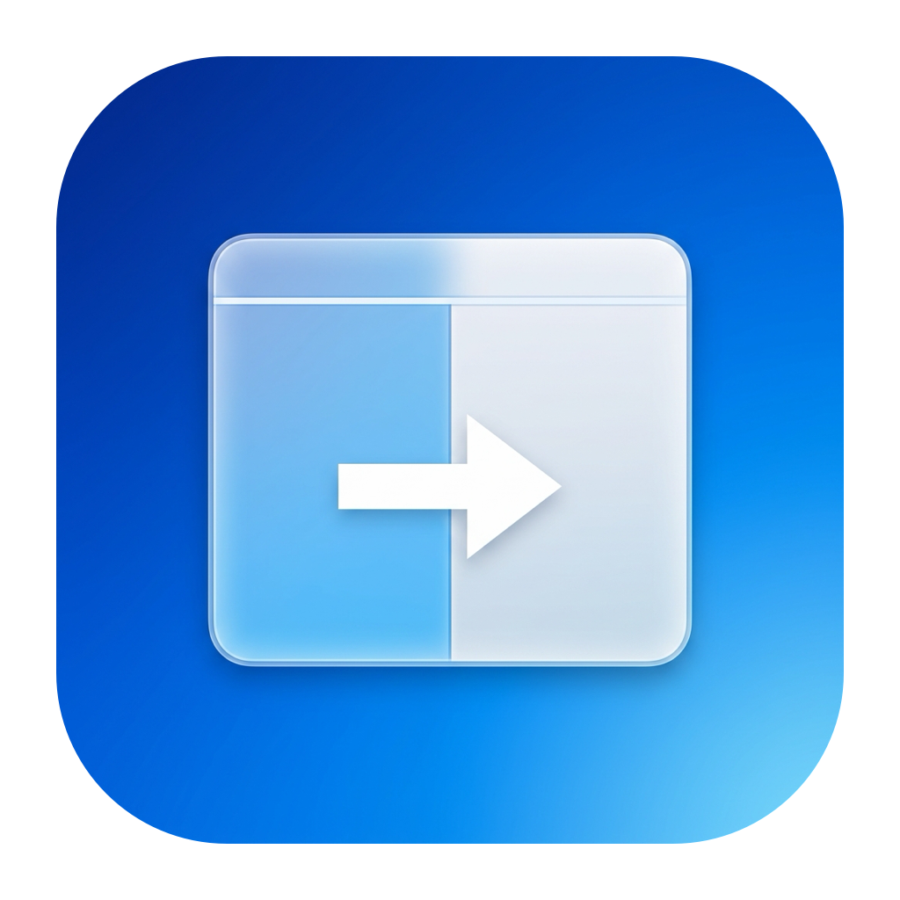

# Moove

A tiny native macOS menu-bar app for moving the focused window. Swift, no third-party dependencies, macOS 13 or newer.

<p align="center"></p>

## Build and run

Requires Apple's Command Line Tools (`xcode-select --install`). A full Xcode installation is not required.

```sh
git clone https://github.com/chriskjaer/moove.git
cd moove
./build.sh
mkdir -p ~/Applications
cp -R dist/Moove.app ~/Applications/
open ~/Applications/Moove.app
```

On first launch, enable **Moove** in **System Settings → Privacy & Security → Accessibility**. This permission is necessary because Moove changes other apps' windows. The menu includes a permission shortcut if you need it later. No Input Monitoring permission is needed: Moove registers six hotkeys rather than observing all keystrokes.

Use the installed app bundle, not `swift run Moove`, so permission is granted to the actual app. Quit before replacing a build. Local builds are ad-hoc signed, not notarized. The build uses an explicit identifier-based designated requirement so its requirement does not change with the executable hash; it is intended only for this personal local app, not authenticated distribution. Accessibility retention across rebuilds still needs live verification. If Settings shows Moove enabled but the menu says permission needed, quit Moove, remove the existing Accessibility entry with the minus button, add the exact app bundle you run with the plus button, enable it, then reopen. An entry from an earlier hash-based build must be replaced.

## Shortcuts

- **Shift + Command + H**: left half of the current display.
- **Shift + Command + J**: bottom half.
- **Shift + Command + K**: top half.
- **Shift + Command + L**: right half.
- **Shift + Command + 1**: move to display 1 and fill it.
- **Shift + Command + 2**: move to display 2 and fill it.

Repeat the same directional shortcut to cycle **50% → 75% → 25% → 50%** of the usable display area, anchored to that edge. Switching edges or starting from an unmatched frame begins at 50%. The cycle recognizes the actual window frame (within 3 points), not a global counter, so changing windows or manually moving one does not carry a stale cycle. Apps that enforce sizes outside that tolerance may restart at 50% rather than cycle. Display-fill shortcuts do not cycle.

The gray menu rows are informational shortcut/status labels, not clickable controls and not indicators of hotkey permission.

Layouts use the usable display area, preserving the menu bar and Dock. Fill is a maximized window, not a separate macOS fullscreen Space. For windows spanning displays, the display with the greatest overlapping area is used.

Display 1 is the primary/menu-bar display in macOS Display settings. The other displays are ordered left to right, then top to bottom. The menu shows their numbers and names; numbering is recalculated when monitors are connected or disconnected. With only one display, Command + Shift + 2 beeps and does nothing.

The shortcuts use the physical H/J/K/L/1/2 keys on an ANSI keyboard layout. They override app-local bindings while Moove runs. If another global hotkey owner has already registered one, its registration failure appears in the menu. Quit other window managers or change conflicting bindings.

## Limitations

Apps can enforce minimum window sizes or discrete resizing increments. Moove reports these adjustments in its status rather than silently claiming an exact half-screen placement. Windows that cannot be moved/resized and windows in native macOS fullscreen are left alone. Errors beep and appear in the menu and icon tooltip.

Only the focused window is changed. Moove does not install a system extension, launch at login, send network traffic, or run commands in other apps. To stop it, choose **Quit Moove**. To uninstall, quit and delete the installed app, then remove its Accessibility entry if desired.

## App icon

The app icon uses a simple split-window and movement-arrow motif, generated with Nano Banana Pro. Source artwork is `Assets/Icon-source.jpg`; `scripts/make-icon.swift` creates the static rounded macOS icon with transparent padding and standard 16–1024 px representations, packaged by `build.sh` as `Moove.icns`. `Assets/Icon.png` is the large preview.

This is a conventional static `.icns` for the Command Line Tools build, not a layered Icon Composer asset or adaptive Liquid Glass icon. The menu-bar icon remains a monochrome SF Symbol. Apple’s [Icon Composer guidance](https://developer.apple.com/documentation/xcode/creating-your-app-icon-using-icon-composer) describes the separate layered workflow for current adaptive icons.

## Diagnostics

`~/Library/Logs/Moove.log` records startup Accessibility trust, shortcut registration, received shortcut IDs, and window-control results. It omits app names, window titles, and typed content. Use the running app's startup/shortcut records as the permission source of truth: invoking the binary with `--diagnostics` from a terminal can have different macOS permission attribution than launching the app with `open`. The log can be deleted when Moove is quit.

## Development

See [Native macOS development checklist](docs/native-development.md) for build/relaunch discipline, signing and Accessibility troubleshooting, shortcut diagnostics, coordinate handling, icon-cache checks, and what constitutes runtime evidence.

## Checks

```sh
swift run GeometryChecks
./build.sh
codesign --verify --strict dist/Moove.app
```

The geometry checks run without XCTest (and therefore without full Xcode). They cover every half layout, displays above/below/left of the primary, menu/Dock insets, odd dimensions, greatest-overlap display selection, and unplugged-display recovery. AppKit and Accessibility both use logical points, avoiding per-display pixel-scale conversions.

Manual acceptance checks after granting permission:

1. Focus an ordinary resizable window and try all four directional shortcuts. Repeat each to check 50%, 75%, 25%, then 50%; switch directions to check that the new edge starts at 50%.
2. Move it between two displays using Command + Shift + 1/2, checking display numbering and usable-area fill.
3. Repeat with displays arranged above/below each other and with different scaling settings.
4. Check a minimum-size window, native fullscreen window, and disconnected second display; confirm the menu reports the limitation.
5. Quit Moove and confirm the shortcuts are released.

Automated geometry checks are not proof that every third-party app honors Accessibility requests. Real window movement and multi-display behavior require the manual checks above.

## License

MIT. See [LICENSE](LICENSE). The icon artwork is included under the same license.
